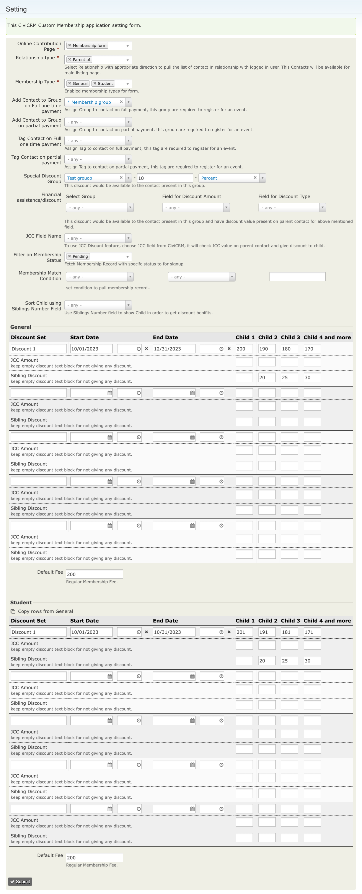
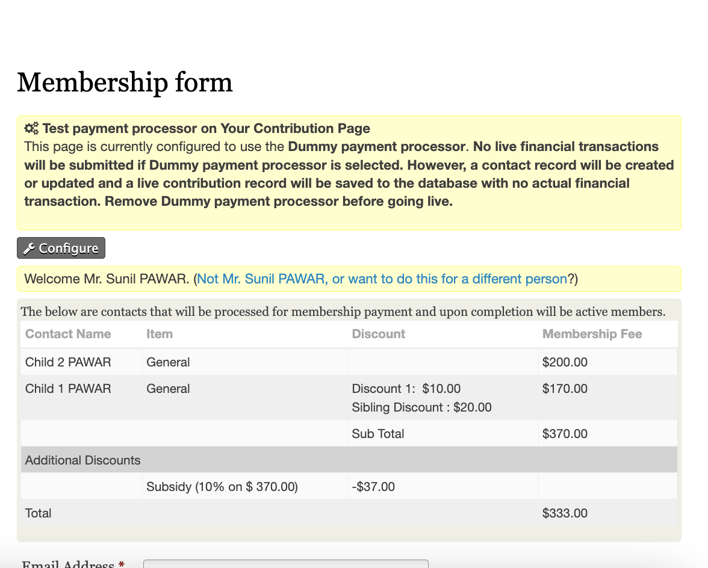
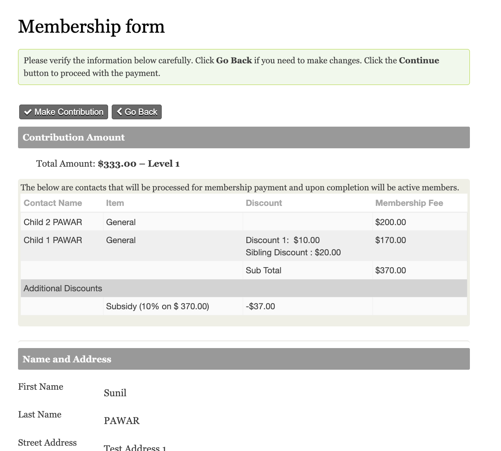

# com.skvare.memberships

Custom membership signup for families. A logged-in parent opens a configured
contribution page, sees which related contacts (usually their children)
already have active memberships and which still need to be paid for, and pays
for all of them in one contribution, with:

* per-child fees with dated discount windows ("early bird"), JCC and sibling
  discounts,
* group-based discounts (financial aid from custom fields, special discount),
* optional installments (recurring payments with a capped number of
  installments),
* membership creation/renewal, line items per child, and group/tag
  assignment once the contribution is processed.



## Requirements

* CiviCRM 6.16 or later (Smarty 5)
* PHP 8.2 or 8.3
* CiviMember enabled, the "Membership Amount" price set
  (`default_membership_type_amount`) with a price option per membership type

## Installation

On the FOIS sites the extension is installed by Composer from the project's
`composer.json` (`extra.civicrm.extensions."com.skvare.memberships"`), then
enabled with:

```bash
cv en memberships
```

Elsewhere, download or clone it into the CiviCRM extensions directory and
enable it from **Administer » System Settings » Extensions** or with `cv en`.

Installing adds `civicrm_contribution_page.is_recur_installments_number`.

## Usage

1. Configure **Administer » CiviMember » Custom Membership Signup Setting**
   (`civicrm/admin/memberships/setting`) for each site/domain.
2. Create a contribution page with a single fee amount and select it in the
   settings. The amount is replaced with the calculated family total.
3. Parents must be logged in; anonymous visitors see a login prompt.





## Documentation

See [`docs/`](docs/index.md):

* [Installation and upgrade](docs/installation.md)
* [Configuration](docs/configuration.md)
* [Signup flow](docs/signup-flow.md)
* [Fees and discounts](docs/fees-and-discounts.md)
* [Memberships and accounting](docs/memberships-and-accounting.md)
* [Integration and dependencies](docs/integration.md)
* [Developer notes](docs/developer.md)
* [Known issues and recommendations](docs/known-issues.md)
* [Changelog](docs/CHANGELOG.md)

## License

AGPL-3.0, see [LICENSE.txt](LICENSE.txt).
